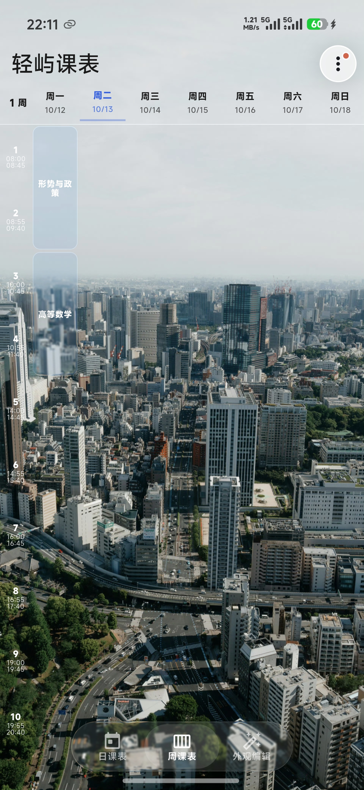
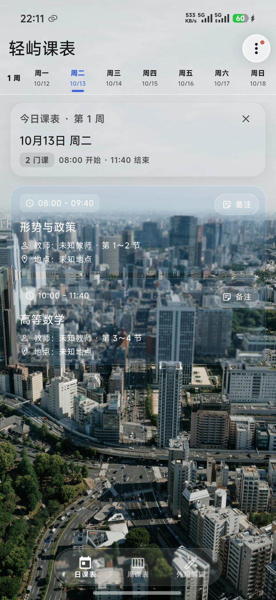
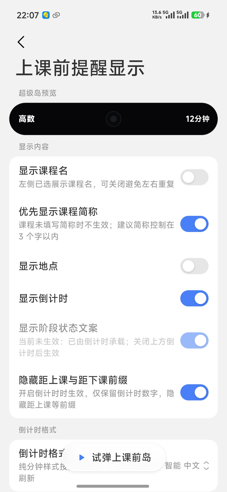
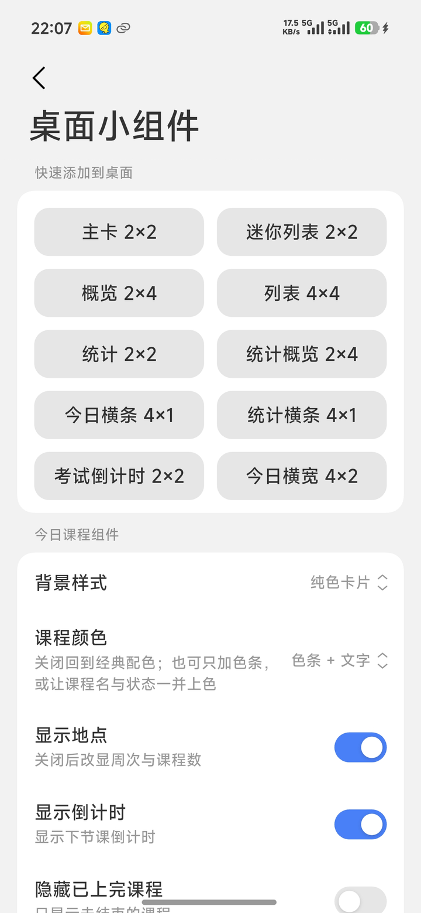
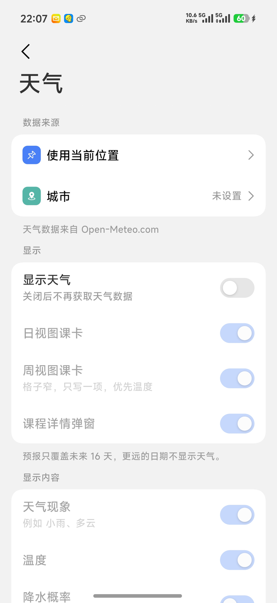
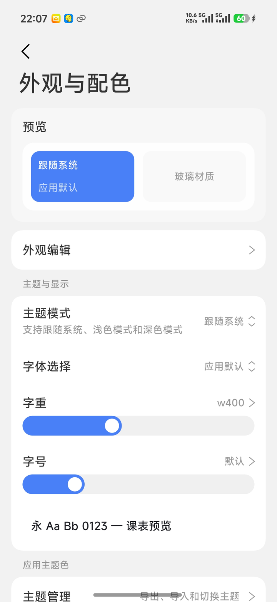
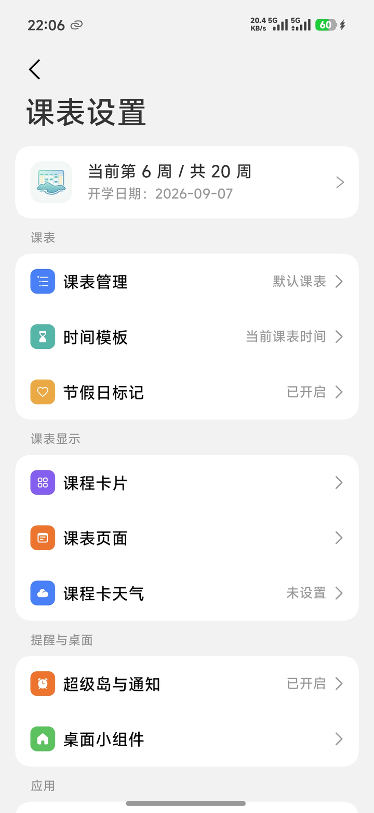
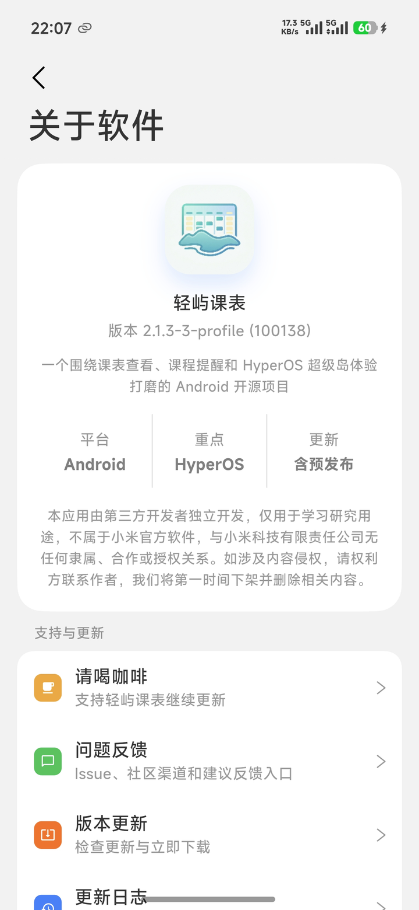

<p align="center">
  
</p>

<h1 align="center">轻屿课表</h1>

<p align="center">
  <strong>面向高校教学场景的 Android 质感课表应用，深度整合 HyperOS 焦点通知与实时活动系统。</strong>
</p>

<p align="center">
  <a href="https://flutter.dev"></a>
  
  
  <a href="https://github.com/Mutx163/mikcb/releases"></a>
  <a href="./LICENSE"></a>
  <a href="https://github.com/Mutx163/mikcb/actions"></a>
</p>

<p align="center">
  <a href="https://163366.xyz">官方站点</a> ·
  <a href="#界面展示">界面展示</a> ·
  <a href="https://docs.163366.xyz/docs/">使用文档</a> ·
  <a href="#获取与安装">下载安装</a> ·
  <a href="https://github.com/Mutx163/mikcb/releases">版本发布</a> ·
  <a href="#教务数据接入与生态支持">教务适配</a>
</p>

---

## 项目概述

轻屿课表以「非侵入式日程感知」为核心设计理念，将教学周历、分阶段动态提醒、通知栏常驻、桌面小组件与系统级灵动胶囊紧密协同。无需频繁开启应用，即可在锁屏、状态栏与桌面上即时获取准确的课程进程。

详细界面演示与设计规范请参阅 [官方站点](https://163366.xyz)。

---

## 界面展示

<p align="center">
  <a href="docs/screenshots/01-week-timetable.png"></a>
  <a href="docs/screenshots/02-day-agenda.png"></a>
  <a href="docs/screenshots/03-super-island.png"></a>
  <a href="docs/screenshots/04-home-widgets.png"></a>
</p>
<p align="center">
  <a href="docs/screenshots/05-weather-integration.png"></a>
  <a href="docs/screenshots/06-appearance-customization.png"></a>
  <a href="docs/screenshots/07-timetable-settings.png"></a>
  <a href="docs/screenshots/08-about-app.png"></a>
</p>

---

## 核心特性

### 1. 深度系统协同与动态提醒
* **HyperOS 超级岛联动**：深度接入小米 HyperOS 焦点通知系统，支持灵动胶囊毫秒级调度与大卡片展开，展开行内容支持自定义显隐与排序。
* **分阶段智能调度**：支持上课前、课中进行、临近下课多阶段动态流转与差异化视觉反馈。
* **桌面小组件矩阵**：提供今日课程、多规格课程概览（2×2 / 2×4）等小组件，与原生数据快照实时同步。
* **系统闹钟批量编排**：基于真实节次作息，通过系统时钟服务一键编排并批量注册早八上课闹钟。

### 2. 液态美学与视觉呈现
* **多层次玻璃拟态**：内置实体卡片、高斯磨砂、柔光玻璃与基于 Impeller Fragment Shader 自研的液态玻璃材质。
* **界面结构自适应**：支持经典布局与液态玻璃底部导航（玻璃坞）双重形态自由切换。
* **壁纸系统独立布局**：支持自定义壁纸位置拖拽微调与历史壁纸缓存管理，切换课表不破坏当前视觉方案。
* **多语言环境支持**：原生支持简体中文、繁体中文（台湾 / 香港）、英语、日语、韩语。

### 3. 全链路日程与协作体系
* **多课表独立隔离**：多套课表数据沙箱隔离与毫秒级即时切换，提醒系统与桌面部件实时跟随。
* **双人情侣课表协同**：支持课表交叉合并比对，智能识别同名同时段课程并聚合呈现，支持桌面组件透出。
* **无网面对面传输**：集成多帧喷泉码（Fountain Codes）二维码传输协议，无网络环境下实现完整课表秒级互传。
* **通用格式导入与导出**：支持标准 `.ics` 日历格式互转与全量数据加密备份迁移。

### 4. 学业统计与多维看板
* **全周期学业分析**：提供周视图与学期视图双维度学时分布与走势分析。
* **课程密度热力图**：直观反映一周日程负荷峰值与空余时段分布。
* **多维结构统计**：按授课教师、教学场地及多课表维度展开结构化汇总。

---

## 获取与安装

当前安装包主要针对 `arm64-v8a` 架构进行编译优化，最低兼容 Android 8.0（API Level 26）。

| 发布渠道 | 渠道类型 | 说明 |
| :--- | :--- | :--- |
| **[蒲公英下载](https://www.pgyer.com/qingyu)** | 国内快速下载通道 | 适合国内移动网络环境，支持手机直接扫码或高速直链免登录下载 |
| **[GitHub Releases](https://github.com/Mutx163/mikcb/releases)** | 官方全量发布渠道 | 正式版与预发布版首发渠道，含完整发布日志与校验文件 |
| **[GitCode 镜像](https://gitcode.com/mutx/qingyu)** | 国内代码与发布镜像 | 国内代码托管镜像，同步提供安装包发布附件 |

> **提示**：应用内已集成多更新源检测服务，用户可根据自身网络环境自由切换更新通道。

---

## 教务数据接入与生态支持

轻屿课表支持主流高校教务系统的网页鉴权导入。适配规则由独立生态仓库持续维护：

* **教务适配中心**：[Mutx163/qingyu_warehouse](https://github.com/Mutx163/qingyu_warehouse)
* **标准格式兼容**：尚未适配教务系统的高校，推荐使用标准 `.ics` 日历文件导入或通过全量数据备份进行迁移。
* **共建规范**：欢迎高校开发者参与教务解析脚本编写，具体接入协议与开发指南请参考教务仓库规范。

---

## 运行环境与权限建议

为确保 HyperOS 超级岛胶囊、实时通知与后台调度服务的稳定运行，建议在系统设置中为本应用授予以下权限：

1. **通知与焦点通知权限**：允许发送常驻通知及在 HyperOS 状态栏展示灵动胶囊；
2. **后台无限制与自启动**：防止系统电源优化机制在锁屏或息屏状态下中断节次轮询调度；
3. **免打扰访问权限**（可选）：若启用了上课前自动静音或免打扰自动化策略，需授予此权限。

相关配置指引亦可在应用内「设置 - 维护与自检 - 后台保活」中查阅与验证。

---

## 开发者指南

### 环境依赖矩阵

| 运行环境 / 工具链 | 推荐版本 | 最低兼容版本 |
| :--- | :--- | :--- |
| **Flutter SDK** | 3.44.8 | 3.44.2 |
| **Dart SDK** | 3.12.2+ | >= 3.12.2 < 4.0.0 |
| **JDK** | 17 | 17 |
| **Android SDK** | API 36 (compileSdk / targetSdk) | API 26 (minSdk) |
| **Android NDK** | 28.2.13676358 | 28.x |
| **Gradle** | 8.14 | 8.10+ |
| **AGP** | 8.11.1 | 8.10+ |

### 本地初始化与运行

```bash
# 获取项目依赖
flutter pub get

# 启动开发环境调试（使用 dev flavor）
flutter run -d android --flavor dev
```

### 质量保证与测试

```bash
# 执行单元测试与架构守卫测试
flutter test

# 执行静态代码分析
flutter analyze --no-fatal-infos
```

### 生产环境构建

```bash
# 构建正式版 release APK (arm64-v8a)
flutter build apk --release --flavor prod --target-platform android-arm64
```

### 工程命名规范与架构映射

| 命名标识 | 作用域与类型 | 规范说明 |
| :--- | :--- | :--- |
| `mikcb` | GitHub 仓库命名 | 项目主代码仓库标识 |
| `university_timetable` | Dart Package Name | 项目基础业务包名（`pubspec.yaml` 标识符） |
| `com.mutx163.qingyu` | Android Application ID | Android 原生包名及应用系统唯一标识 |
| **轻屿课表** | 产品可见名称 | 面向终端用户的正式产品名称 |

---

## 技术架构

* **UI 框架**：Flutter (Material 3 + [flutter_miuix](https://github.com/w568w/flutter_miuix) HyperOS 风格组件套件)
* **状态管理**：Provider
* **图形渲染**：自研 Liquid Glass Fragment Shader（运行于 Impeller 渲染后端）
* **系统底层集成**：Android Notification / Ongoing Promoted Activity / Foreground Service / AlarmClock
* **数据离线传输**：`fountain_codes` + `mobile_scanner`
* **工程集成与监控**：GitHub Actions CI/CD · 友盟移动统计 (U-APM)

---

## 文档索引

* [贡献指南 (CONTRIBUTING.md)](./CONTRIBUTING.md)
* [行为准则 (CODE_OF_CONDUCT.md)](./CODE_OF_CONDUCT.md)
* [安全策略 (SECURITY.md)](./SECURITY.md)
* [隐私合规声明 (docs/PRIVACY.md)](./docs/PRIVACY.md)
* [第三方开源许可 (docs/THIRD_PARTY_LICENSES.md)](./docs/THIRD_PARTY_LICENSES.md)
* [发布流程规范 (docs/RELEASE.md)](./docs/RELEASE.md)
* [国际化协作规范 (docs/WEB_AND_L10N_WORKFLOW.md)](./docs/WEB_AND_L10N_WORKFLOW.md)

---

## 贡献者致谢

感谢所有为轻屿课表生态贡献力量的开发者与高校志愿者：

<a href="https://github.com/Mutx163/mikcb/graphs/contributors">
  
</a>

### 教务适配生态致谢

教务解析脚本依托于 [qingyu_warehouse](https://github.com/Mutx163/qingyu_warehouse)，持续同步自上游开源项目 [shiguang_warehouse](https://github.com/XingHeYuZhuan/shiguang_warehouse)。特向所有参与高校教务解析规则适配的贡献者致以崇高敬意：

<!-- CONTRIBUTORS:AUTO:START -->

<!-- CONTRIBUTORS:AUTO:END -->

以下开发者直接向教务适配仓库提交过代码，谨此致谢：

<!-- CONTRIBUTORS_DIRECT:AUTO:START -->

<!-- CONTRIBUTORS_DIRECT:AUTO:END -->

*(教务适配贡献者名单由自动化构建任务定期同步生成)*

---

## Star History

<a href="https://www.star-history.com/?repos=mutx163%2Fmikcb&type=timeline&logscale=&releases=&legend=bottom-right">
 <picture>
   <source media="(prefers-color-scheme: dark)" srcset="https://api.star-history.com/chart?repos=mutx163/mikcb&type=timeline&theme=dark&legend=bottom-right" />
   <source media="(prefers-color-scheme: light)" srcset="https://api.star-history.com/chart?repos=mutx163/mikcb&type=timeline&legend=bottom-right" />
   
 </picture>
</a>

---

## 开源许可证

本项目源码采用 [GNU General Public License v3.0 (GPL-3.0-or-later)](./LICENSE) 协议授权。

随应用集成的第三方 SDK 及依赖库许可证清单请参阅 [docs/THIRD_PARTY_LICENSES.md](./docs/THIRD_PARTY_LICENSES.md)。
